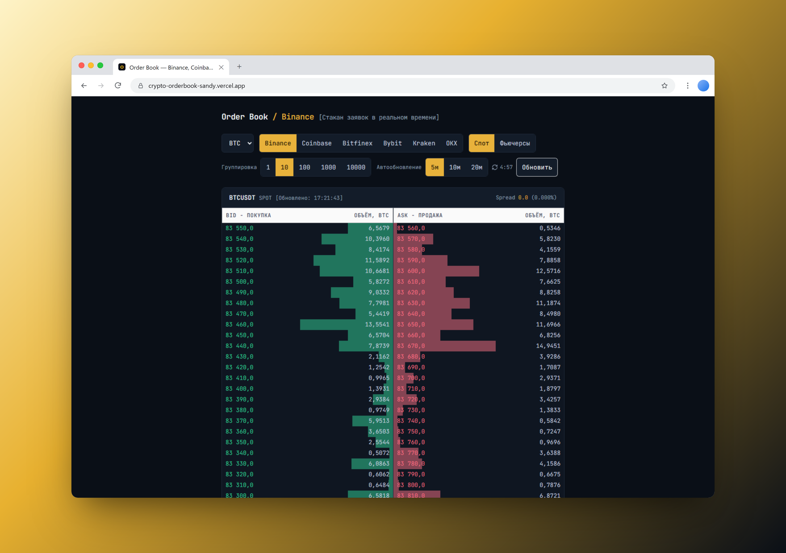

<div align="center">

# 📊 Crypto Order Book — Real-time Market Depth

**Six exchanges, one order book.**
A fast, dark-themed order book viewer for Binance, Coinbase, Bitfinex, Kraken, Bybit and OKX —
spot and futures, price grouping, volume heatmap and auto-refresh.

[](https://nextjs.org/)
[](https://react.dev/)
[](https://www.typescriptlang.org/)
[](https://tailwindcss.com/)
[](https://nodejs.org/)
[](LICENSE)

🌐 **Live:** [crypto-orderbook-sandy.vercel.app](https://crypto-orderbook-sandy.vercel.app/)

<a href="https://crypto-orderbook-sandy.vercel.app/">
  
</a>

</div>

---

## 📋 Table of Contents

- [✨ Features](#-features)
- [🧰 Tech Stack](#-tech-stack)
- [🚀 Quick Start](#-quick-start)
- [⚙️ Configuration](#️-configuration)
- [🏦 Supported Exchanges](#-supported-exchanges)
- [🔌 API](#-api)
- [🧮 How the Order Book Is Built](#-how-the-order-book-is-built)
- [📜 Scripts](#-scripts)
- [🗂️ Project Structure](#️-project-structure)
- [♿ Accessibility & Performance](#-accessibility--performance)
- [☁️ Deployment](#️-deployment)
- [✅ Quality Checks](#-quality-checks)
- [🗺️ Roadmap](#️-roadmap)
- [📄 License](#-license)

---

## ✨ Features

|                           |                                                                                    |
| ------------------------- | ---------------------------------------------------------------------------------- |
| 🏦 **Six exchanges**      | Binance, Coinbase, Bitfinex, Kraken, Bybit and OKX behind one unified data model   |
| 🔀 **Spot / Futures**     | One-click switch; markets an exchange does not offer are disabled, not hidden      |
| 🪙 **Assets**             | BTC, ETH, SOL, XRP, BNB / LTC — the list follows each exchange's own listing       |
| 🧮 **Price grouping**     | Thousands of raw levels collapsed into a readable table, step chosen automatically |
| 🔥 **Volume heatmap**     | Every row shows its own volume against the largest visible level — walls stand out |
| 📏 **Spread**             | Absolute and percentage spread between the best bid and the best ask               |
| ⏱️ **Auto-refresh**       | Base interval from `.env` with ×2 / ×4 options, live countdown, manual refresh     |
| 💾 **Remembers settings** | Exchange, asset, market, grouping step and interval are kept in `localStorage`     |
| 🛡️ **Server-side proxy**  | Exchanges are queried by the API route — no CORS issues, no client IP exposure     |

> The interface language is Russian.

---

## 🧰 Tech Stack

| Layer     | Technology                                                        |
| --------- | ----------------------------------------------------------------- |
| Framework | **Next.js 16** (App Router, Turbopack)                            |
| UI        | **React 19**, **Tailwind CSS 3**, JetBrains Mono via `next/font`  |
| Language  | **TypeScript** — `strict`                                         |
| Data      | Public REST APIs of the exchanges — **no API keys required**      |
| Tooling   | ESLint 9 (typescript-eslint strict), Prettier, husky, lint-staged |

> No database, no secrets, no runtime dependencies besides Next.js and React.

---

## 🚀 Quick Start

**Requirements:** Node.js **24.x** (20.9+ works as well).

```bash
# 1. Clone
git clone https://github.com/lpcms/crypto-orderbook.git
cd crypto-orderbook

# 2. Install dependencies
npm install

# 3. Start the dev server
npm run dev
```

Open **http://localhost:3000**.

---

## ⚙️ Configuration

All settings live in the committed [`.env`](.env) file. It holds **only public, non-secret
defaults**, so there is no `.env.example`; put machine-specific overrides into `.env.local`
(git-ignored).

| Variable                                | Default | Purpose                                                                                                                                                   |
| --------------------------------------- | :-----: | --------------------------------------------------------------------------------------------------------------------------------------------------------- |
| `NEXT_PUBLIC_ORDERBOOK_REFRESH_SECONDS` |  `300`  | Base auto-refresh interval in seconds. The UI offers this value, ×2 and ×4 (5 → 10 → 20 min)                                                              |
| `ORDERBOOK_DEPTH_LIMIT`                 | `5000`  | Raw levels requested from Binance. Allowed: 5, 10, 20, 50, 100, 500, 1000, 5000. Futures accept at most 1000 — an unsupported value is clamped per market |

> `NEXT_PUBLIC_*` variables are inlined into the client bundle at build time — rebuild after
> changing them.

---

## 🏦 Supported Exchanges

| Exchange | Markets       | Depth                                       | Notes                                                                                                                  |
| -------- | ------------- | ------------------------------------------- | ---------------------------------------------------------------------------------------------------------------------- |
| Binance  | spot, futures | up to 5000 (spot) / 1000 (USDT-M futures)   | Raw levels, grouped on the client — `lib/exchanges/binance.ts`                                                         |
| Coinbase | spot          | full book, **already aggregated** by price  | Public API has no derivatives; level 3 (every single order) is too heavy — `lib/exchanges/coinbase.ts`                 |
| Bitfinex | spot          | up to 250 per side (`len=250`, the maximum) | Bids and asks share one `[price, count, amount]` array; the sign of `amount` is the side — `lib/exchanges/bitfinex.ts` |
| Kraken   | spot          | up to 500 per side                          | Bitcoin is `XBT` (`XBTUSD`); the response key differs from the requested pair — `lib/exchanges/kraken.ts`              |
| Bybit    | spot, futures | 200 (spot) / 500 (linear perpetual)         | v5 API, `category=spot` / `linear`; errors signalled by `retCode !== 0` — `lib/exchanges/bybit.ts`                     |
| OKX      | spot, futures | up to 400 per side                          | Spot `BTC-USDT`, futures = perpetual swap `BTC-USDT-SWAP`; errors by `code !== "0"` — `lib/exchanges/okx.ts`           |

Supported markets and assets per exchange are declared once, in `SUPPORTED_MARKETS` and
`EXCHANGE_ASSETS` in [`lib/types.ts`](lib/types.ts).

### ➕ Adding an exchange

1. Create `lib/exchanges/<name>.ts` that maps the exchange's response to `OrderBookData`.
2. Add one `case` to the dispatcher in [`lib/exchanges/index.ts`](lib/exchanges/index.ts).
3. Register the exchange in `Exchange`, `SUPPORTED_MARKETS`, `EXCHANGE_ASSETS` and
   `toExchangeSymbol` in [`lib/types.ts`](lib/types.ts), and in `KNOWN_EXCHANGES` of the API route.

---

## 🔌 API

```http
GET /api/orderbook?exchange=binance&symbol=BTCUSDT&market=spot
```

| Parameter  | Values                                                                              | Default   |
| ---------- | ----------------------------------------------------------------------------------- | --------- |
| `exchange` | `binance` · `coinbase` · `bitfinex` · `kraken` · `bybit` · `okx`                    | `binance` |
| `symbol`   | Exchange-native symbol (`BTCUSDT`, `BTC-USD`, `tBTCUSD`, `XBTUSD`, `BTC-USDT-SWAP`) | `BTCUSDT` |
| `market`   | `spot` · `futures`                                                                  | `spot`    |

Response (`200`):

```json
{
  "exchange": "binance",
  "symbol": "BTCUSDT",
  "market": "spot",
  "bids": [{ "price": 64250.1, "amount": 1.234 }],
  "asks": [{ "price": 64250.2, "amount": 0.567 }],
  "fetchedAt": 1760000000000
}
```

Errors: `400` for an unknown exchange or market, `502` when the exchange itself fails —
both with `{ "error": "..." }`.

---

## 🧮 How the Order Book Is Built

### Price grouping

The full depth is fetched (up to 5000 levels from Binance) and grouped on the client by a price
step in [`lib/aggregate.ts`](lib/aggregate.ts) — the same technique as the `0.1 / 1 / 10 / 100`
selector on the exchanges themselves:

- **bids round down, asks round up**, so the apparent liquidity is never inflated;
- the step is suggested from the asset price (`suggestTick`) and can be changed in the UI;
- at most **50 rows per side** are shown (`DISPLAY_ROWS` in `app/page.tsx`).

> 🐞 **Fixed edge case.** Naive `Math.floor(price / tick) * tick` maps every order cheaper than
> the step to a bucket `0`, producing a phantom level "price 0, volume 24 210". Such orders now
> keep their real price instead of being collapsed.

### Volume heatmap

The bar behind each row is that level's **own** volume relative to the largest visible level —
the standard for order-book tables (Binance / Bybit / OKX), which makes liquidity walls obvious.
Cumulative volume is deliberately not used: it belongs to a depth chart, and in a table it would
show the row farthest from the spread at ~100% regardless of its real liquidity. Volume is always
labelled in the base asset (`Объём, BTC`).

---

## 📜 Scripts

| Command             | Description                                 |
| ------------------- | ------------------------------------------- |
| `npm run dev`       | Development server on http://localhost:3000 |
| `npm run build`     | Production build                            |
| `npm start`         | Production server (after `npm run build`)   |
| `npm run lint`      | ESLint                                      |
| `npm run typecheck` | TypeScript check (`tsc --noEmit`)           |
| `npm run check`     | **All checks** — `tsc` + ESLint             |
| `npm run format`    | Prettier                                    |

---

## 🗂️ Project Structure

```text
crypto-orderbook/
├── app/
│   ├── api/orderbook/route.ts  # server proxy: validates params, calls the dispatcher
│   ├── layout.tsx              # metadata, viewport, self-hosted font
│   ├── page.tsx                # controls, state, auto-refresh, persisted settings
│   ├── globals.css
│   └── icon.svg
├── components/
│   ├── OrderBook.tsx           # header, spread, grouping, two sides
│   └── OrderBookSide.tsx       # one side with the volume heatmap
├── docs/
│   └── preview.png             # README screenshot
├── lib/
│   ├── exchanges/              # one adapter per exchange + index.ts dispatcher
│   ├── aggregate.ts            # price grouping and step suggestions
│   ├── storage.ts              # localStorage helpers
│   └── types.ts                # shared contract, markets and assets per exchange
├── .env                        # public defaults (committed)
├── vercel.json                 # Vercel function region
└── tailwind.config.ts
```

---

## ♿ Accessibility & Performance

- **Contrast** — no text below WCAG AA 4.5:1 on the dark background; the light BID/ASK header
  uses dark text for the same reason.
- **Readable sizes** — nothing smaller than 12 px.
- **Accessible names** — a visually hidden `<label>` for the asset select, `role="group"` with
  `aria-label` / `aria-labelledby` for every button group.
- **Toggle state** — `aria-pressed` on exchange, market, grouping and interval buttons.
- **Keyboard focus** — a visible `focus-visible` ring on every interactive element.
- **Live regions** — the refresh countdown is `aria-live="polite"`, errors are `role="alert"`,
  loading is `role="status"`.
- **Fonts** — JetBrains Mono through `next/font`: self-hosted, `display: swap`, no request to
  Google Fonts.
- **Small bundle** — only the page itself is a client component.

---

## ☁️ Deployment

### ▲ Vercel (recommended)

1. Import the repository in Vercel — Next.js and Node.js 24 are detected automatically.
2. No environment variables are required (`.env` is committed).
3. Deploy.

> ⚠️ **Exchange geo-blocking.** Binance and Bybit reject requests from US IP addresses
> (`451` / `403`), and Vercel runs functions in Washington, D.C. (`iad1`) by default.
> [`vercel.json`](vercel.json) therefore pins the functions to **Frankfurt (`fra1`)**. If an exchange
> still answers with an error, pick another region there.

### 🖥️ Own server / Node.js hosting

```bash
npm ci
npm run build
npm start            # PORT=3000 by default
```

Put the app behind NGINX (or the panel's proxy) for TLS. The server must be located where the
exchanges' public APIs are available.

---

## ✅ Quality Checks

```bash
npm run check        # tsc --noEmit + eslint
npm run build
```

A pre-commit hook (husky + lint-staged) runs ESLint and Prettier on staged files.

---

## 🗺️ Roadmap

- 📡 WebSocket streams instead of polling (`wss://stream.binance.com:9443/ws/<symbol>@depth20@100ms`)
  — can be opened straight from the client.
- 📈 A separate depth chart with cumulative volume.
- 🔄 Symbol lists loaded dynamically (`/exchangeInfo` and the equivalents).
- 🧪 Unit tests for the exchange adapters' response mapping.

---

## 📄 License

Distributed under the **Apache License 2.0** — see [LICENSE](LICENSE).

<div align="center">

Made with ❤️ for traders who read the tape 📈

</div>
